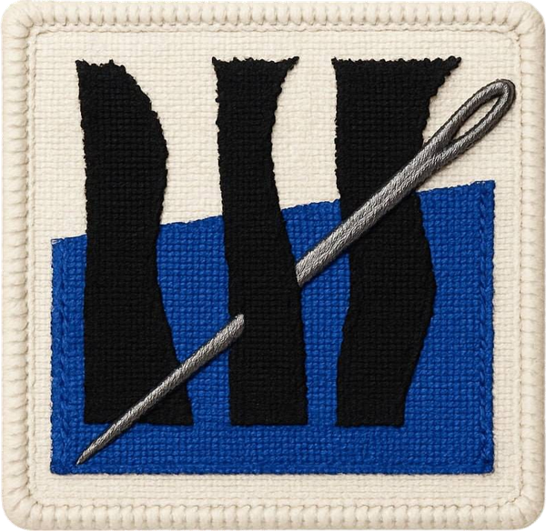

::: {.hero}
::: {}

<b class="c">S</b>cientific <b class="c">T</b>eams and <b class="c">I</b>nequali<b class="c">T</b>ies: <b class="c">C</b>ollaboration and <b class="c">H</b>eterogeneity in Science

How scientific teams divide their work, and how that division stitches inequality into the research system.

:::

{fig-alt="STITCH embroidered patch: three black strips crossed by a needle over a blue band"}
:::

::: {.boxes}

::: {.box .box-wide}
## News

::: {#latest-news}
:::

[See all news →](news.qmd){.more}
:::

::: {.box}
## Outputs

::: {#latest-outputs}
:::

[See all outputs →](outputs.qmd){.more}
:::

::: {.box .box-tint}
## Outreach

::: {#latest-outreach}
:::

[See all outreach →](outreach.qmd){.more}
:::

<!-- SIDE B · soundtrack, ready but switched off. Remove the comment markers to activate.
::: {.box .box-cobalt .box-wide}
## The STITCH soundtrack

Side B

Research has a rhythm. Four moments of team science, forty songs, chosen by the team.

::: {.boxes}
::: {}
**01 · Assembling the team**
<ol class="tracks"><li>to be picked</li></ol>
:::
::: {}
**02 · Dividing the work**
<ol class="tracks"><li>to be picked</li></ol>
:::
::: {}
**03 · Who gets the credit**
<ol class="tracks"><li>to be picked</li></ol>
:::
::: {}
**04 · When the data hurts**
<ol class="tracks"><li>to be picked</li></ol>
:::
:::
:::
-->

:::
