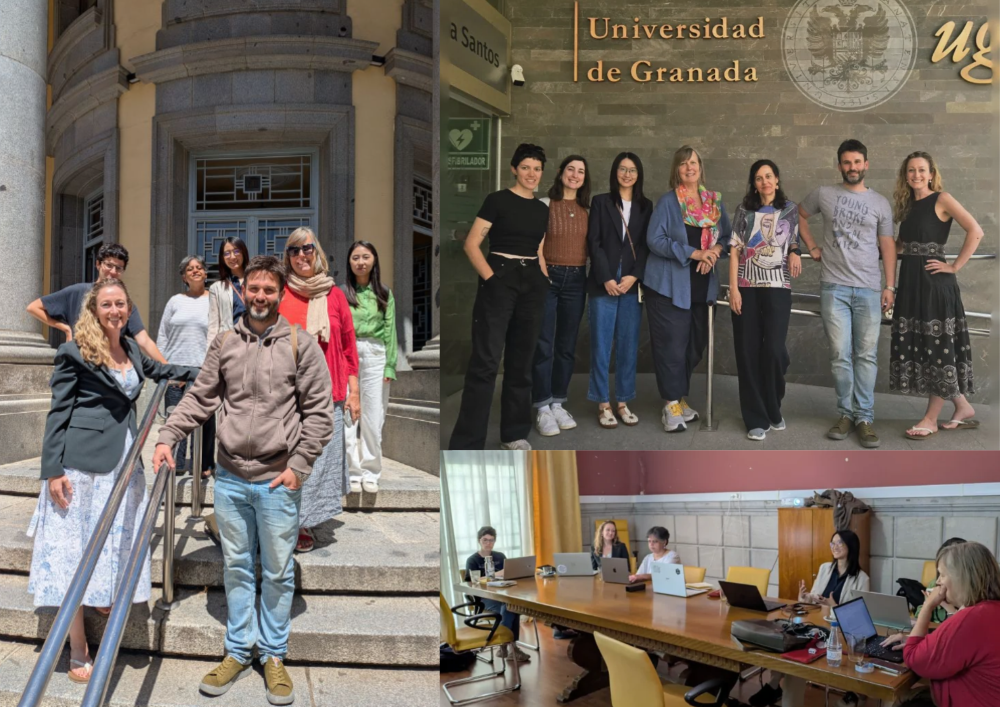

STITCH aims to explore how scientific teams are organized, how responsibilities are distributed among researchers and how these dynamics contribute to inequalities in science. 

Recently, **the [STITCH team →](https://uchass-ugr.github.io/stitch/team.html) came together to kick off the project, share ideas, and discuss the first steps of this new research initiative.** Through bibliometric analysis and advanced data-driven methods, the project seeks to provide new insights into scientific collaboration and support fairer and more inclusive research practices. 

We’re incredibly proud to bring together such a talented and diverse international team to make this project a reality! We look forward to continuing our collaboration and moving the project forward together.

---
